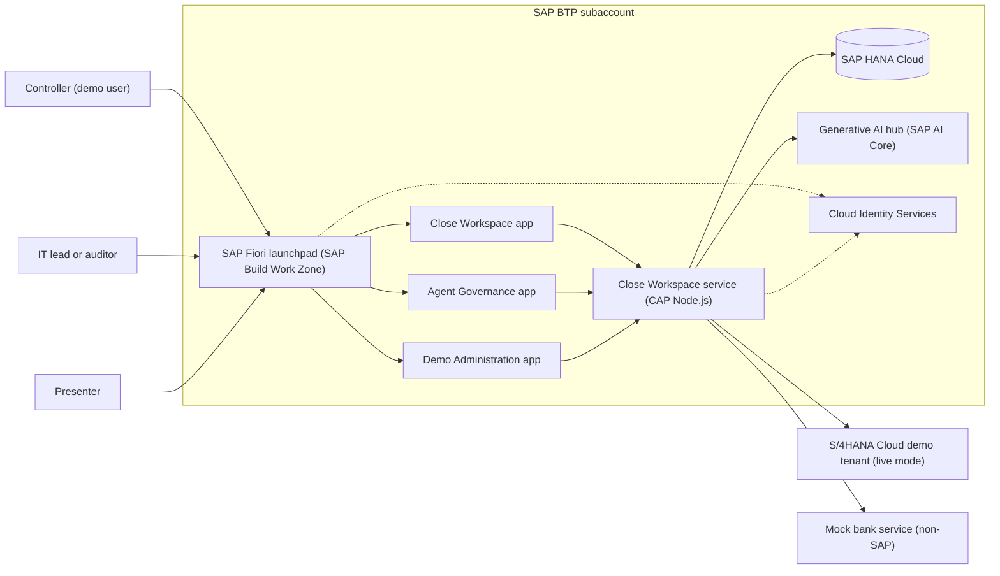
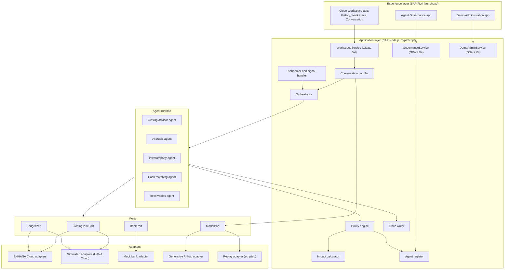
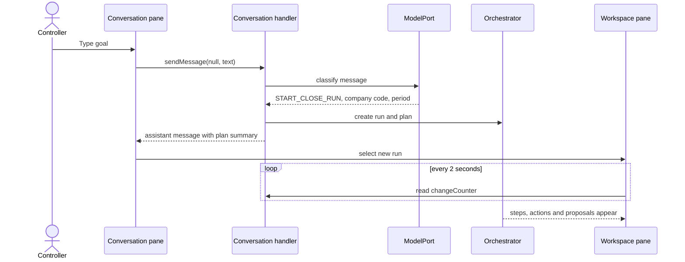
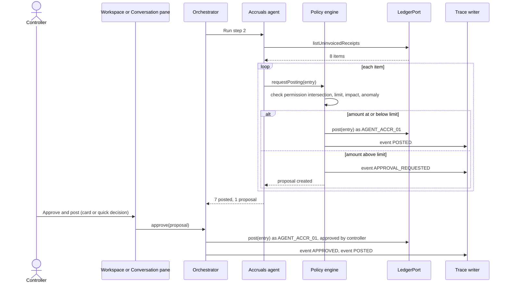
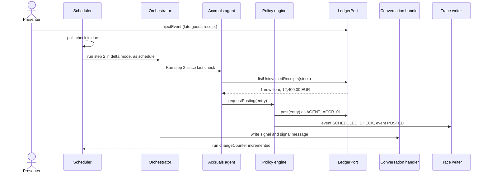
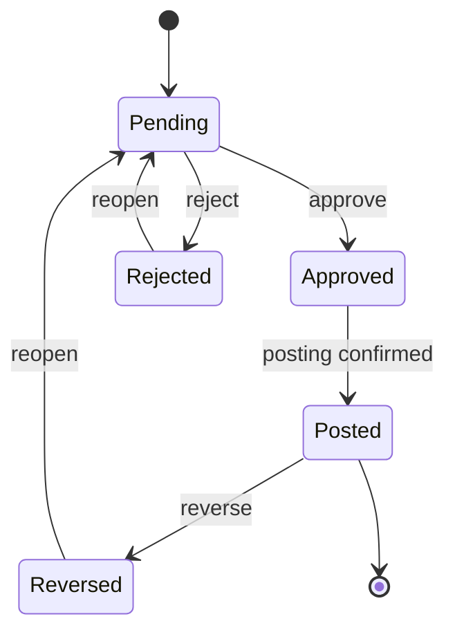

# Technical Solution Architecture Specification: Autonomous Finance Close Demo ("Close Workspace")

| Field | Value |
|---|---|
| Document type | Technical solution architecture specification |
| Version | 0.4 (draft for review) |
| Date | 22 November 2026 |
| Owner | [Owner name] |
| Companion document | Intent Specification, `autonomous-finance-demo-intent-spec.md`, version 0.4 |
| Scope | Demonstration prototype. Not a production design. |

Identifiers such as INT-04, R1 and scene numbers refer to the intent specification.

## Change log

| Version | Change |
|---|---|
| 0.4 | Backend changed from CAP Java to CAP Node.js with TypeScript (AD-01). New sections 1.1 Technology stack and 1.2 App composition. The demonstration is now three Fiori apps: Close Workspace (freestyle), Agent Governance and Demo Administration (both Fiori elements). New `GovernanceService`. Agent loops on LangGraph JS, scheduling on CAP event queues. New decisions AD-14 and AD-15, new rule FE-23, new risks T13 and T14. |
| 0.3 | SAP Fiori made mandatory: new section 6 with development rules FE-01 to FE-22, quality gates, rules for AI-assisted development and a deviation log. User interface design (5.1) rebuilt on Fiori patterns: launchpad shell, responsive splitter, feed controls. Decisions AD-02 revised and AD-13 added. Build plan and risks updated. Sections 6 to 15 of version 0.2 are now sections 7 to 16. |
| 0.2 | User interface redesigned as three panes (History, Workspace, Conversation). New components: conversation handler, scheduler, signal handler, impact calculator, agent register. Policy engine extended with the permission intersection (R9) and the clearing rule (R10). Data model and service interface extended. New mapping to the parts of Joule Work. Build plan re-estimated. |
| 0.1 | First draft. |

## 1. Architecture summary

The demonstration is one SAP BTP solution with four parts:

1. **Three SAP Fiori apps** on one SAP Fiori launchpad: **Close Workspace** for the controller, with the panes History, Workspace and Conversation; **Agent Governance** for the IT lead and auditor; and **Demo Administration** for the presenter.
2. **One CAP Node.js service**, written in TypeScript, that owns the conversation, the run state, the approval rules, the scheduled checks, the trace and the agent runtime.
3. **Five agents**, running inside that service, that read and post accounting data through a port interface. The ports are bound either to an S/4HANA Cloud demo tenant (live mode) or to the solution's own SAP HANA Cloud schema (simulated mode).
4. **One mock bank service** that stands in for a non-SAP system.

Language models are reached through the generative AI hub in SAP AI Core. They are used to classify what the user typed, to choose among a bounded set of tools, and to phrase replies and explanations. They are never the source of a number or of an approval decision.

### 1.1 Technology stack

TypeScript is the only programming language, for apps, services and agents. Exact versions are pinned at build start and recorded in the repository.

| Layer | Choice | Note |
|---|---|---|
| Language | TypeScript, strict mode | Same compiler and lint rules for apps and services |
| Runtime | Node.js 24 LTS | The version CAP 10 recommends. Node.js 22 is its minimum. |
| Backend framework | SAP Cloud Application Programming Model for Node.js, version 10, with `cds-typer` for generated model types | From CAP 10.2, TypeScript service handlers run without extra tooling on Node.js 24 and above |
| Service protocol | OData V4 | Required by the Fiori rules (section 6) |
| Database | SAP HANA Cloud through an HDI container (`@cap-js/hana`). SQLite in memory for local work (`@cap-js/sqlite`). | |
| Model access | SAP Cloud SDK for AI for JavaScript against the orchestration service of the generative AI hub | `@sap-ai-sdk/orchestration`, `@sap-ai-sdk/langchain` |
| Agent loops | LangGraph JS, one bounded graph per agent | Policy engine stays plain TypeScript, outside the model (AD-03) |
| Validation | `zod` schemas for tool inputs, tool outputs and structured model output | |
| Scheduling | Recurring task in the CAP event queue. Fallback: interval poller. | AD-11, risk T13 |
| S/4HANA Cloud integration | CAP remote services over BTP destinations for OData. HTTP client for the SOAP posting service. | Risk T14 |
| Security | XSUAA with Cloud Identity Services as identity provider, `@sap/xssec` | |
| Freestyle app | SAPUI5, TypeScript, XML views, Horizon theme, UI5 CLI | Close Workspace |
| Generated apps | SAP Fiori elements for OData V4, configured by CDS annotations | Agent Governance, Demo Administration |
| Tests | `cds.test` with Jest for services, agents and policy. OPA5 or wdi5 for the apps. | One journey per Must intent |
| Static checks | TypeScript compiler, ESLint 9, UI5 linter, the Fiori gate scripts of section 6.3 | |
| Build and deploy | Multi-target application on Cloud Foundry, HTML5 application repository, SAP Build Work Zone standard edition | |
| Development tools | `cds watch` with a hybrid profile for bound BTP services, SAP Fiori tools, Visual Studio Code or SAP Business Application Studio | |

### 1.2 App composition

**Apps on the launchpad**

| App | Type | User | Service | Content |
|---|---|---|---|---|
| Close Workspace | SAPUI5 freestyle | Controller | `WorkspaceService` | History, Workspace and Conversation panes. Mapping view. |
| Agent Governance | Fiori elements, list report and object page | IT lead, auditor | `GovernanceService` | Agent register, trace across runs, model usage |
| Demo Administration | Fiori elements, list report and object page | Presenter | `DemoAdminService` | Configuration, customer rule, mapping texts, reset, mode, scripted switch, event injection, scene selection |

**Backend and platform pieces**

| Piece | Type | Content |
|---|---|---|
| `srv` | CAP Node.js, one process | Three services, plus the internal modules: conversation handler, orchestrator, five agents, policy engine, impact calculator, scheduler, ports and adapters |
| `db` | HDI container | Data model and CSV seed data |
| `mock-bank` | Small Node.js service | Bank statement lines over REST |
| Platform services | SAP BTP | Work Zone site, XSUAA, SAP AI Core, SAP HANA Cloud, Destination |

**Repository layout**

```
close-workspace/
  app/
    workspace/        SAPUI5 freestyle, TypeScript
    governance/       Fiori elements
    admin/            Fiori elements
  srv/
    services/         CDS service definitions, annotations and handlers
    conversation/
    orchestrator/
    agents/           one folder per agent, with its tools
    policy/
    impact/
    scheduler/
    ports/            TypeScript interfaces
    adapters/         s4/, simulated/, bank/, model/, replay/
  db/                 schema and CSV seed data
  mock-bank/
  test/
  docs/               both specifications, fiori-deviations.md
  mta.yaml
```

Composition rules:

- **One backend process.** Agents are modules, not microservices. The ports keep the option of exposing them through the Agent2Agent protocol later.
- **One service per app.** Each app sees only the entities and actions it needs, which keeps authorisation simple: `Controller` for the workspace, `Auditor` for governance, `DemoAdmin` for administration.
- **No shared UI code between apps.** The status vocabulary is delivered by the services as code plus criticality, so that the freestyle formatter and the Fiori elements annotations render the same state.

## 2. Architecture decisions

| ID | Decision | Reason | Alternative considered |
|---|---|---|---|
| AD-01 | CAP Node.js with TypeScript on Cloud Foundry for the service layer | One language across apps, services and agents. SAP's reference pattern for pro-code agents is CAP plus the SAP Cloud SDK for AI, and both support TypeScript. Fast iteration with `cds watch`. | CAP Java. Stricter compile-time typing, but a second language and slower iteration for a prototype. |
| AD-02 | Close Workspace is an SAPUI5 freestyle app in TypeScript, built from standard controls only | SAP Fiori is the mandatory design style (intent spec, section 9). The three-pane structure does not fit a Fiori elements floorplan, so freestyle is needed here, but every element follows a Fiori guideline article. | Fiori elements for the workspace. Compliant by construction, but cannot hold workspace and conversation side by side. |
| AD-03 | Policy checks run in code, outside the model | Approval limits, permissions and segregation of duties must be deterministic and testable (R1, R2, R3, R9, R10) | Let the model decide when to ask for approval. Rejected: not auditable. |
| AD-04 | Each agent is a bounded tool-calling loop | Shows real agent behaviour while keeping the tool set and iteration count small enough to be predictable on stage | Fixed scripted pipeline. Safer, but not an agent. |
| AD-05 | Ports and adapters for all accounting data | One code path for live and simulated mode | Separate demo branches. Rejected: drift between modes. |
| AD-06 | Polling for updates: a change counter per run every 2 seconds, the History list every 10 seconds | Simple and robust behind an application router | Server-sent events. Better latency, more failure modes on conference networks. |
| AD-07 | Scripted switch replays stored model responses | Stage safety (G7) | Rely on live calls only. Rejected. |
| AD-08 | Customer rule held as data | Changeable after the discovery call without deployment (INT-07) | Rule in code. |
| AD-09 | The conversation is a persisted thread per run, with a closed list of message intents | Gives the look and continuity of a chat while keeping behaviour predictable (INT-11) | Open-ended chat with free tool use. Rejected for a stage demo. |
| AD-10 | Decisions are always executed by the same service actions, whether triggered from a card or from a quick decision in the thread | One code path, one state, R11 enforced in one place | Separate chat command execution. Rejected. |
| AD-11 | Sensing through scheduled checks, driven by a recurring task in the CAP event queue, with a plain interval poller as fallback | Enough to show the behaviour (G8) with no extra infrastructure | Business events from S/4HANA Cloud through an event broker. Correct for production, listed for phase 2. |
| AD-13 | The three panes use the Fiori responsive splitter layout inside the launchpad shell | The Fiori guideline excludes the flexible column layout for a main area with side panes and points to the responsive splitter for that case | Flexible column layout, or a tool page with side navigation. Both rejected as not guideline-conform for this structure. |
| AD-12 | Permission intersection is evaluated in the policy engine before every tool call | Mirrors the principle SAP describes for its agent gateway, without depending on it | Rely on the agent's technical user alone. Rejected: an agent could exceed what the user may do. |
| AD-14 | Three apps on one launchpad: Close Workspace, Agent Governance, Demo Administration. The last two are SAP Fiori elements apps. | Governance and administration are lists and forms, which Fiori elements generates from annotations with almost no UI code and full guideline conformance (FD-18). The controller's screen stays focused. | One app with dialogs for the register and demo control. Less navigation, but more freestyle code to keep compliant. |
| AD-15 | Agent loops are built with LangGraph JS on the orchestration client of the SAP Cloud SDK for AI. Agents run in the service process. | A maintained framework for bounded tool-calling loops in TypeScript, on SAP's supported model access path. In-process agents avoid deployment work that adds nothing to the demo. | Hand-written loop on the orchestration client: fewer dependencies, kept as the fallback. One microservice per agent: rejected for a prototype. |

## 3. System context



## 4. Logical architecture



## 5. Components

### 5.1 User interface

All three apps are SAP Fiori apps. Section 6 holds the mandatory design and development rules. The control choices below follow those rules and are confirmed in a one-day UI spike at the start of the UI work package.

**Close Workspace (freestyle)**

| Area | Intents | Fiori pattern | SAPUI5 control (proposal) |
|---|---|---|---|
| Shell | FD-06 | SAP Fiori launchpad shell bar | Provided by the launchpad. The app renders none. |
| Page frame | Section 7.2 of the intent spec, FD-05 | Responsive splitter layout | `sap.ui.layout.ResponsiveSplitter` with three split panes. History and Conversation move to paging when the width is too small. |
| **History pane** | INT-12, INT-13 | List with filter | `sap.m.Page` with `sap.m.SegmentedButton` filter and `sap.m.List` of `sap.m.ObjectListItem` for runs. Second list for scheduled checks with a cancel action. Link to the Agent Governance app through launchpad navigation. |
| **Workspace pane**, frame | INT-02, INT-09, INT-16 | Dynamic page | `sap.f.DynamicPage`. Title shows the goal. A title action opens the mapping view. Header shows company code, period, mode, scene status tag (`sap.m.ObjectStatus`) and the key figures (`sap.m.ObjectNumber`). |
| Workspace pane, notice | Section 7.2 of the intent spec | Message strip | `sap.m.MessageStrip`, type Information, not closable: "Partner concept prototype. Not an SAP product." A second strip in simulated mode: "Sample data". |
| Workspace pane, plan | INT-02, INT-13 | List | `sap.m.List` with `sap.m.ObjectListItem`, status as `sap.m.ObjectStatus`, and a "Schedule Check" action per step |
| Workspace pane, decisions | INT-04, INT-05, INT-14 | Card | `sap.f.Card` per proposal. Impact as `sap.m.ObjectNumber`. Anomaly as `sap.m.MessageStrip`, type Warning. Approve and Reject as buttons of type Accept and Reject. Evidence in a `sap.m.Panel` with a responsive `sap.m.Table` of posting lines and a list of source documents. |
| Workspace pane, tabs | INT-03, INT-08 | Icon tab bar | `sap.m.IconTabBar` with Activity (`sap.m.List`) and Trace (responsive `sap.m.Table`, read-only, sortable) |
| **Conversation pane**, thread | INT-01, INT-11, INT-13 | Feed | `sap.m.List` of `sap.m.FeedListItem`. Quick decisions are feed item actions. Signals use an information icon and the sender name of the scheduled check. AI-generated messages carry the AI notice (intent spec, section 9.3). |
| Conversation pane, input | INT-01, INT-11 | Feed input with AI button | `sap.m.FeedInput` or a text area with the Fiori AI button, and three suggested prompts as link buttons above it |
| Empty states | FD-10 | Illustrated message | `sap.m.IllustratedMessage` in each pane when no run is selected or a list is empty |
| Mapping view | INT-16 | Dialog with table | `sap.m.Dialog` with a responsive `sap.m.Table`: prototype part, SAP standard counterpart, status text |

- Data binding: OData V4 model against `WorkspaceService`.
- Updates: while a run is open, the app reads `Runs(ID)/changeCounter` every 2 seconds and refreshes the pane bindings only when the value has changed. The History list refreshes every 10 seconds (AD-06).
- Selection: selecting a run sets one binding context that both the Workspace and the Conversation pane use, so they cannot show different runs.
- Links from an assistant message to a proposal scroll the Workspace to that card and expand its evidence.
- New assistant messages and signals are announced to screen readers through `sap.ui.core.InvisibleMessage` (FD-14).

**Agent Governance (Fiori elements)**

| Page | Intents | Floorplan | Content from annotations |
|---|---|---|---|
| Agents | INT-15 | List report | Table of agents: purpose, owner, autonomy rule, technical user, action count, model calls. Filter bar on owner. |
| Agent | INT-15 | Object page | Header with purpose and technical user. Sections: tools and permissions, trace events of this agent, model usage. |
| Trace | INT-08, INT-15 | List report, second entity set reached by a tab or a second tile target | Table of trace events across runs: time, run, actor, actor type, action, text, reference. Filters on run, agent and actor type. Each row navigates to its run in Close Workspace. |

- Service: `GovernanceService`, read-only. No create, edit or delete capability is annotated.
- No custom sections and no controller extensions (FE-23).

**Demo Administration (Fiori elements)**

| Page | Intents | Floorplan | Content from annotations |
|---|---|---|---|
| Settings | INT-10, INT-07 | List report on `Config` | Table of configuration entries: auto-post limit, customer rule, mode, scripted switch, scene. Toolbar actions: Reset Demo, Inject Event, Run Checks Now. |
| Setting | INT-10 | Object page | Edit one configuration value with a short description of its effect |
| Mapping texts | INT-16 | List report and object page on `MappingEntries` | Maintain prototype part, SAP standard counterpart and status text |

- Service: `DemoAdminService`, restricted to the `DemoAdmin` role.
- Reset Demo asks for confirmation through the standard action confirmation of Fiori elements.
- How unbound actions are placed in the list report toolbar is confirmed at the start of the work package (risk T15).

### 5.2 Application service (CAP Node.js, TypeScript)

- **WorkspaceService**: read access to runs, messages, plan steps, proposals, evidence, agent actions, handoffs, scheduled checks, signals, trace and mapping entries, with actions for messages, decisions and scheduled checks. Serves Close Workspace.
- **GovernanceService**: read-only access to the agent register, model usage, trace events and runs. Serves Agent Governance.
- **DemoAdminService**: serves Demo Administration: reset, mode switch, scripted switch, event injection, scene selection, rule and status-text configuration.
- **Conversation handler**: stores each user message, calls the model once to classify it into one of the message intents below, executes the matching handler, and stores the assistant reply.

  | Message intent | Handler |
  |---|---|
  | `START_CLOSE_RUN` | Creates the run and hands it to the orchestrator. Allowed only when no run is selected. |
  | `ASK_BLOCKERS` | Reads open steps, pending proposals and open handoffs, and replies with a list. |
  | `EXPLAIN_PROPOSAL` | Replies with the reason code text, the rule that held it, and any anomaly flag. |
  | `SHOW_EVIDENCE` | Replies with a link that opens the evidence of the proposal. |
  | `REQUEST_DECISION` | Replies with a quick decision for the proposal. Executes nothing (R11). |
  | `SUMMARISE` | Calls the summary action if step 5 is ready. Otherwise says what is still open. |
  | `SCHEDULE_CHECK` | Creates a scheduled check for the named step after confirming interval and step in the reply. |
  | `OUT_OF_SCOPE` | Replies that this is not part of the prototype. |

- **Orchestrator**: instantiates the plan template for the scenario and schedules the agents. For a scheduled check it runs one step in delta mode.
- **Policy engine**: plain TypeScript, no model calls and no framework dependency. Before any tool call it evaluates the permission intersection (R9). For every posting or clearing it evaluates R1, R2, R3 and R10 and returns `AUTO_POST` or `HOLD_FOR_APPROVAL` with a reason code.
- **Impact calculator**: plain TypeScript. For each proposal it computes the effect on the period result from the profit-and-loss lines, the change in open blockers, and the anomaly flag against the three-month average (R13). It also maintains the key figures on the run.
- **Scheduler and signal handler**: a recurring task in the CAP event queue runs every 30 seconds, looks for scheduled checks that are due, runs them through the orchestrator, and writes a signal and a signal message when a check finds something new (R12). If event queue scheduling is not released in the pinned CAP version, an interval poller started at server launch does the same job.
- **Trace writer**: the only component allowed to insert trace events. Insert only.
- **Agent register**: read model of the agents, their tools and permissions, joined with usage counters.

### 5.3 Agent runtime

Each agent is a bounded tool-calling loop: the model receives the agent's task, the tool descriptions and the tool results so far, and returns either a tool call or a final result. The loop is a LangGraph JS graph on the orchestration client of the SAP Cloud SDK for AI (AD-15). Limits: at most 8 iterations and a 30-second budget per agent step. All tool inputs and outputs are validated in code against schemas defined with `zod`.

| Agent | Task | Tools | Autonomy rule | Technical user |
|---|---|---|---|---|
| Closing advisor | Read the closing task list, rank open tasks by dependency, apply the customer rule (INT-07) | `listClosingTasks`, `getTaskDependencies`, `evaluateCustomerRule` | Read-only | `AGENT_CLOSE_01` |
| Accruals | Find goods received without invoice, prepare accrual entries, post or propose | `listUninvoicedReceipts`, `buildAccrualEntry`, `requestPosting` | R1 | `AGENT_ACCR_01` |
| Intercompany | Compare intercompany balances, propose a correction for each difference | `listIntercompanyItems`, `buildCorrectionEntry`, `requestPosting` | R2 | `AGENT_ICO_01` |
| Cash matching | Match bank lines to open items, hand off what it cannot match (INT-06) | `listBankLines`, `findOpenItemCandidates`, `createHandoff` | Auto-match only on exact amount and reference | `AGENT_CASH_01` |
| Receivables | Resolve handoffs by customer and amount, clear or propose | `getHandoff`, `findCustomerOpenItems`, `requestClearing` | R10 | `AGENT_AR_01` |

- `requestPosting` and `requestClearing` never post directly. They pass the prepared document to the policy engine (AD-03).
- Read tools accept a `since` parameter. A scheduled check calls them with the time of the previous check, so that the agent sees only new items.

### 5.4 Model access

- Access through the generative AI hub orchestration service using the SAP Cloud SDK for AI for JavaScript (`@sap-ai-sdk/orchestration`, and `@sap-ai-sdk/langchain` for the agent loops).
- Model: configurable by deployment ID. Temperature 0. Structured (JSON schema) output for message classification and tool calls.
- Uses of the model: message classification (INT-01, INT-11), tool selection inside each agent loop, phrasing of assistant replies, explanation text on proposals (R5), and the close summary (INT-09).
- Number safety: reply, explanation and summary prompts receive figures as named placeholders. The service substitutes the values after generation and rejects any output that contains a digit sequence not present in the input data (R4, R13).
- Scripted switch: `ModelPort` is bound to a replay adapter that returns stored responses keyed by prompt hash. Stored responses are recorded from a successful rehearsal run that follows the storyline word for word.
- Usage: every model call increments the usage counter for its agent or for the conversation handler (INT-15).

### 5.5 Persistence

SAP HANA Cloud through an HDI container. Local development uses SQLite in memory. The model is in section 8.

### 5.6 Integration

| Port | Live adapter | Simulated adapter |
|---|---|---|
| `ClosingTaskPort` | Closing task source in the demo tenant. To be confirmed: if no released read API fits, tasks stay in the simulated store in both modes. | `sim.ClosingTasks` |
| `LedgerPort` (read) | Released OData read APIs for purchase orders, material documents and open accounting items | `sim.Receipts`, `sim.OpenItems`, `sim.AccrualHistory` |
| `LedgerPort` (post) | Released journal entry posting service | `sim.JournalEntries` |
| `BankPort` | Mock bank service in both modes | Same |

Candidate S/4HANA Cloud Public Edition interfaces. All names must be verified on SAP Business Accelerator Hub for the tenant's release before the build starts:

| Purpose | Candidate | Note |
|---|---|---|
| Post journal entry | Journal Entry – Post (synchronous SOAP), communication scenario `SAP_COM_0002` | Also the route for reversals |
| Read purchase orders | Purchase Order OData API, communication scenario `SAP_COM_0053` | For goods received, not invoiced |
| Read goods receipts | Material Document OData API, communication scenario `SAP_COM_0108` | Filter by posting time for scheduled checks |
| Read open items | Operational journal entry item read API | For intercompany and customer items, and for the three-month history |
| Clear open items | Journal entry clearing service | Asynchronous in the standard. The adapter must poll for the result. |

Each agent's technical user maps to its own communication user and communication arrangement in the tenant, so that the posting user in S/4HANA is the agent, not a shared integration user (INT-08).

Live adapters use CAP remote services over BTP destinations for the OData APIs, and an HTTP client with a typed request builder for the SOAP posting service.

The mock bank service is a small REST service in the same subaccount with one endpoint that returns statement lines. It stands in for a non-SAP system.

## 6. SAP Fiori design and development rules (mandatory)

**Every app in this demonstration is an SAP Fiori app, built with SAPUI5 to the SAP Fiori Design Guidelines.** This section turns the design rules FD-01 to FD-18 of the intent specification (section 9) into development rules. All rules are Must. A build that violates a rule without an approved entry in the deviation log does not pass the pipeline and is not shown to a customer.

The rules build on SAP's own baseline for Fiori apps: an approved UX design, SAPUI5 as the UI technology, OData services, no custom CSS, a mandatory app descriptor, and operation in the SAP Fiori launchpad.

### 6.1 Framework and project rules

| ID | Rule | Implements |
|---|---|---|
| FE-01 | **SAPUI5 only.** The UI is built with SAPUI5 in the latest long-term maintenance version available at build start. The exact version is pinned in `ui5.yaml` and as `minUI5Version` in `manifest.json`, and the Fiori guideline version used for design matches it. No other UI framework and no third-party UI library. | FD-01, FD-02 |
| FE-02 | **Library allow-list.** Allowed control libraries in the freestyle app: `sap.m`, `sap.f`, `sap.ui.core`, `sap.ui.layout`, `sap.uxap`. `sap.suite.ui.commons` is allowed for the timeline control only. The Fiori elements apps use the `sap.fe` libraries their template declares and nothing else. Any other library needs a deviation entry. | FD-02 |
| FE-03 | **No custom controls, no HTML.** No control extensions, no `sap.ui.core.HTML`, no direct DOM access, no jQuery calls on rendered elements. | FD-02 |
| FE-04 | **No custom CSS.** The project contains no CSS file and no `style` attributes. `addStyleClass` and `class` may reference only the documented SAPUI5 margin, padding and content density classes. | FD-03 |
| FE-05 | **Theme.** Default theme `sap_horizon`. The app is tested in `sap_horizon_dark`, `sap_horizon_hcb` and `sap_horizon_hcw`. No colour, font or size literals in views or controllers. | FD-04 |
| FE-06 | **Project structure.** Close Workspace is generated with SAP Fiori tools or the UI5 CLI from the freestyle TypeScript template: component-based, asynchronous loading, XML views, typed controllers, routing and models declared in `manifest.json`. The Fiori elements apps are generated with the SAP Fiori tools list report template for OData V4. | FD-01 |
| FE-07 | **TypeScript.** Strict mode. ES module imports. Control-specific event types for handlers. No `any` in controller code without a comment that gives the reason. | Quality |
| FE-08 | **Launchpad integration.** The app is deployed to the HTML5 application repository and started from a tile in SAP Build Work Zone, standard edition. It declares its inbound navigation in `manifest.json`, renders no shell bar, and uses the launchpad services for title and navigation. | FD-06 |
| FE-09 | **Content density.** The app applies the content density the launchpad provides and supports cozy and compact. | FD-15 |
| FE-10 | **Content security policy.** No inline scripts, no `eval`, no external resources outside the SAPUI5 delivery. | Quality |
| FE-23 | **Fiori elements first.** A screen whose structure fits a standard floorplan is built with SAP Fiori elements and CDS annotations, with no custom sections or controller extensions unless a deviation is approved. Freestyle SAPUI5 needs an architecture decision that names the reason (today AD-02 only). | FD-18 |

### 6.2 View and binding rules

| ID | Rule | Implements |
|---|---|---|
| FE-11 | **Layout.** The three panes are split panes of one `sap.ui.layout.ResponsiveSplitter`. `sap.f.FlexibleColumnLayout` and `sap.tnt.ToolPage` are not used for the pane frame. Each pane hosts a standard page or dynamic page. | FD-05 |
| FE-12 | **Status rendering.** Every status is rendered with `sap.m.ObjectStatus` (or the `state` of the hosting control) through one shared formatter that implements the status vocabulary of the intent specification, section 9.2. No view sets a state literal by itself. The services expose each status with a criticality value, which the Fiori elements apps render through annotations, so all three apps show the same state. | FD-07 |
| FE-13 | **Actions.** Button `type` values come from the standard set. One emphasised button per toolbar at most. Approve uses `Accept`, Reject uses `Reject`. Destructive or irreversible actions are confirmed with `sap.m.MessageBox`. | FD-08 |
| FE-14 | **Messages.** Service messages are bound through the SAPUI5 message model and shown with `sap.m.MessageStrip`, `sap.m.MessageBox`, `sap.m.MessageToast` or `sap.m.MessagePopover`. No `alert`, no custom message area. | FD-09 |
| FE-15 | **Empty and busy states.** Lists and tables set `noData` to an `sap.m.IllustratedMessage`. Panes use the standard `busy` indication with `busyIndicatorDelay`. | FD-10 |
| FE-16 | **AI elements.** The AI notice, AI button and explanation elements use the SAPUI5 controls or UI5 Web Components that the Fiori AI guidelines name for the pinned version. Notice texts come from `i18n` with the guideline wording. A view shows the notice only on bindings flagged as AI-generated by the service (`Messages.role = ASSISTANT`, proposal explanation, summary). | FD-11 |
| FE-17 | **Formatting.** Amounts, numbers, dates and times are bound with OData or SAPUI5 types (`Currency`, `Decimal`, `DateTimeOffset`). No manual string formatting. Amount columns are right-aligned. | FD-12 |
| FE-18 | **Texts.** Every user-visible text is in `i18n.properties` with a text-type annotation. No string concatenation for sentences: use placeholders. No text literals in views or controllers. | FD-13 |
| FE-19 | **Accessibility.** Every input has a label (`labelFor` or `ariaLabelledBy`). Icon-only buttons have tooltips. Tables have titles. Focus is set deliberately after dialogs close and after a run is selected. New messages and signals are announced with `sap.ui.core.InvisibleMessage`. | FD-14 |
| FE-20 | **Responsiveness.** Split panes define `requiredParentWidth` and `demandPane` so that the Workspace stays visible longest. Tables are responsive tables with pop-in behaviour for sizes S and M. | FD-15 |
| FE-21 | **Icons.** Only `sap-icon://` icons from the standard SAP icon font. | FD-16 |
| FE-22 | **Forms.** Forms use `sap.ui.layout.form.Form` with a column layout, not `SimpleForm`. | FD-01 |

### 6.3 Quality gates

Automated, run in the pipeline on every change:

| Gate | Tool | Pass condition |
|---|---|---|
| Legacy and deprecated API use | UI5 linter | Zero findings |
| Types and code style | TypeScript compiler, ESLint | Zero errors |
| Custom styling | Script that fails on any `.css` file, `style=` attribute, or class outside the allow-list | Zero matches |
| Library allow-list | Script over `manifest.json` and view namespaces | Only allowed libraries |
| Text literals | Script over views for unbound text properties | Zero matches |
| Behaviour | OPA5 or wdi5 journeys, one per Must intent | All pass |
| Framework rules | SAPUI5 Support Assistant rule sets for accessibility, bindings and consistency | No high-severity issue |

Manual, at the compliance gate before each rehearsal and customer session:

- Walk every scene against FD-01 to FD-16 and FD-18 with the Fiori guideline open.
- Run scenes 1, 2 and 6 with the keyboard only, and once with a screen reader.
- Check every scene in the four Horizon themes, at sizes S, M, L and XL, and in both densities.
- Review the deviation log. Target: no entries.

### 6.4 Rules for AI-assisted development

Where a coding agent writes or changes UI code:

- **Load the rules.** Sections 6.1 to 6.3 and the status vocabulary are part of the agent's project instructions, so that it applies them without being reminded.
- **Use SAP's UI5 tooling for agents.** SAP publishes a UI5 plugin for coding agents with an MCP server that gives access to the API reference, the UI5 linter and SAP's development guidelines. The agent must use it for control APIs, not its own recall.
- **Same gates.** Generated code passes the gates in section 6.3 before it is committed. A failing gate is fixed, not suppressed.
- **Name the guideline.** Each generated view states, in the work item, which Fiori guideline article it implements (FD-01).

### 6.5 Deviation log

`docs/fiori-deviations.md` in the repository. One row per deviation: rule ID, guideline article, what deviates, reason, owner approval, date, and the plan to remove it. An empty file is the expected state.

## 7. Runtime behaviour

### 7.1 Scene 1, from message to workspace



### 7.2 Scene 2, posting with approval



### 7.3 Scene 5, a late event is sensed



`injectEvent` also sets the next due time of the active check to now, so that the scheduler picks it up within its 30-second poll. A "run checks now" admin action removes even that wait. Both are Demo Administration actions and are exempt from the 5-minute minimum interval in R12.

### 7.4 Proposal states



### 7.5 Run, step and check states

- Run: `PLANNING`, `RUNNING`, `WAITING_FOR_DECISION`, `COMPLETED`, `FAILED`. A run "needs action" when it has a proposal in `Pending` or a signal in `NEW`.
- Plan step: `NOT_STARTED`, `IN_PROGRESS`, `NEEDS_DECISION`, `HANDED_OVER`, `DONE`, `REJECTED_RETURNED`, `READY`.
- Step 5 (summary) moves to `READY` when steps 2 and 3 have no proposal in `Pending`.
- Scheduled check: `ACTIVE`, `CANCELLED`, `ENDED`. A check ends when its run is `COMPLETED` or 72 hours after creation (R12).
- Signal: `NEW`, `SEEN`.

### 7.6 Failure handling

- A failed tool call ends the agent step with status `FAILED` and an activity entry in plain language (R7). The run continues with independent steps.
- Posting uses an idempotency key stored before the call. A repeated request returns the stored document number (R6).
- A model call that exceeds 15 seconds is cancelled. If message classification fails, the assistant replies that it could not process the message and nothing is executed.
- A scheduled check that fails writes a trace event and stays active for the next interval.

## 8. Data model

```cds
namespace closeworkspace;

using { cuid, managed } from '@sap/cds/common';

entity Runs : cuid, managed {
  title            : String(120);
  goalText         : String(500);
  scenario         : String(40);          // CLOSE_STATUS
  companyCode      : String(4);
  fiscalPeriod     : String(7);           // MM/YYYY
  mode             : String(10);          // LIVE, SIMULATED
  status           : String(30);
  startedBy        : String(60);
  authSnapshot     : String(1000);        // permissions of the starting user, for R9
  changeCounter    : Integer default 0;
  postingsAuto     : Integer default 0;
  postingsApproved : Integer default 0;
  blockersAtStart  : Integer;
  blockersNow      : Integer;
  closeReadyAt     : Timestamp;
  messages         : Composition of many Messages on messages.run = $self;
  steps            : Composition of many PlanSteps on steps.run = $self;
  proposals        : Composition of many Proposals on proposals.run = $self;
  actions          : Composition of many AgentActions on actions.run = $self;
  checks           : Composition of many ScheduledChecks on checks.run = $self;
  signals          : Composition of many Signals on signals.run = $self;
  events           : Composition of many TraceEvents on events.run = $self;
}

entity Messages : cuid {
  run           : Association to Runs;
  seqNo         : Integer;
  role          : String(10);             // USER, ASSISTANT, SIGNAL
  text          : String(2000);
  messageIntent : String(30);
  proposal      : Association to Proposals;
  quickDecision : Boolean default false;
  createdAt     : Timestamp;
}

entity PlanSteps : cuid {
  run      : Association to Runs;
  seqNo    : Integer;
  title    : String(80);
  note     : String(200);
  agent    : String(40);
  status   : String(30);
}

entity AgentActions : cuid {
  run        : Association to Runs;
  step       : Association to PlanSteps;
  agent      : String(40);
  text       : String(300);
  status     : String(30);
  occurredAt : Timestamp;
}

entity Proposals : cuid {
  run              : Association to Runs;
  step             : Association to PlanSteps;
  title            : String(120);
  summary          : String(500);
  amount           : Decimal(15, 2);
  currency         : String(3);
  agent            : String(40);
  reasonCode       : String(30);          // OVER_LIMIT, SECOND_COMPANY_CODE, NO_UNIQUE_MATCH
  reasonText       : String(200);
  effectOnResult   : Decimal(15, 2);
  blockersDelta    : Integer;
  anomaly          : Boolean default false;
  referenceAverage : Decimal(15, 2);
  status           : String(20);          // PENDING, APPROVED, REJECTED, POSTED, REVERSED
  documentNumber   : String(20);
  idempotencyKey   : String(80);
  decidedBy        : String(60);
  decidedAt        : Timestamp;
  lines            : Composition of many ProposalLines on lines.proposal = $self;
  sources          : Composition of many EvidenceItems on sources.proposal = $self;
}

entity ProposalLines : cuid {
  proposal    : Association to Proposals;
  companyCode : String(4);
  glAccount   : String(10);
  accountText : String(60);
  debit       : Decimal(15, 2);
  credit      : Decimal(15, 2);
}

entity EvidenceItems : cuid {
  proposal    : Association to Proposals;
  description : String(200);
  reference   : String(40);
}

entity Handoffs : cuid {
  run       : Association to Runs;
  fromAgent : String(40);
  toAgent   : String(40);
  subject   : String(200);
  reference : String(40);
  status    : String(20);                 // OPEN, RESOLVED, NEEDS_DECISION
}

entity ScheduledChecks : cuid {
  run             : Association to Runs;
  step            : Association to PlanSteps;
  intervalMinutes : Integer;
  status          : String(10);           // ACTIVE, CANCELLED, ENDED
  createdBy       : String(60);
  lastCheckedAt   : Timestamp;
  nextDueAt       : Timestamp;
  lastResult      : String(200);
}

entity Signals : cuid {
  run        : Association to Runs;
  sourceCheck : Association to ScheduledChecks;
  text       : String(300);
  reference  : String(40);
  status     : String(10);                // NEW, SEEN
  occurredAt : Timestamp;
}

entity TraceEvents : cuid {
  run        : Association to Runs;
  occurredAt : Timestamp;
  actor      : String(60);
  actorType  : String(10);                // AGENT, HUMAN, SCHEDULE
  action     : String(40);
  text       : String(300);
  reference  : String(40);
}

entity AgentRegistry {
  key agent          : String(40);
      purpose        : String(200);
      owner          : String(60);
      tools          : String(500);
      autonomyRule   : String(200);
      technicalUser  : String(40);
      allowedActions : String(200);       // READ_TASKS, POST_JOURNAL, CLEAR_ITEM ...
      companyCodes   : String(100);
}

entity ModelUsage : cuid {
  run          : Association to Runs;
  consumer     : String(40);              // agent name or CONVERSATION
  calls        : Integer default 0;
  inputTokens  : Integer default 0;
  outputTokens : Integer default 0;
}

entity MappingEntries : cuid {
  seqNo       : Integer;
  part        : String(80);               // prototype part
  counterpart : String(120);              // SAP standard counterpart
  statusText  : String(200);              // availability, maintained before each session
}

entity Config {
  key configKey   : String(40);           // AUTO_POST_LIMIT, CUSTOMER_RULE, MODE, SCRIPTED, SCENE
      configValue : String(1000);
}
```

Simulated-mode tables (`sim.ClosingTasks`, `sim.Receipts`, `sim.OpenItems`, `sim.AccrualHistory`, `sim.BankLines`, `sim.JournalEntries`) live in a separate namespace and are loaded from CSV seed files. The seed set is defined in the section "Demo data intent" of the intent specification.

## 9. Service interface

```cds
service WorkspaceService @(requires: 'authenticated-user') {
  @readonly entity Runs            as projection on closeworkspace.Runs;
  @readonly entity Messages        as projection on closeworkspace.Messages;
  @readonly entity PlanSteps       as projection on closeworkspace.PlanSteps;
  @readonly entity AgentActions    as projection on closeworkspace.AgentActions;
  @readonly entity Proposals       as projection on closeworkspace.Proposals;
  @readonly entity Handoffs        as projection on closeworkspace.Handoffs;
  @readonly entity ScheduledChecks as projection on closeworkspace.ScheduledChecks;
  @readonly entity Signals         as projection on closeworkspace.Signals;
  @readonly entity TraceEvents     as projection on closeworkspace.TraceEvents;
  @readonly entity MappingEntries  as projection on closeworkspace.MappingEntries;

  // runID empty: the message may start a new run
  @(requires: 'Controller') action sendMessage(runID : UUID, text : String) returns Messages;

  @(requires: 'Controller') action approve(proposalID : UUID) returns Proposals;
  @(requires: 'Controller') action reject(proposalID : UUID)  returns Proposals;
  @(requires: 'Controller') action reverse(proposalID : UUID) returns Proposals;
  @(requires: 'Controller') action reopen(proposalID : UUID)  returns Proposals;
  @(requires: 'Controller') action summarise(runID : UUID)    returns Messages;

  @(requires: 'Controller') action scheduleCheck(stepID : UUID, intervalMinutes : Integer) returns ScheduledChecks;
  @(requires: 'Controller') action cancelCheck(checkID : UUID);
  action markSignalsSeen(runID : UUID);
}

service GovernanceService @(requires: ['Auditor', 'Controller', 'DemoAdmin']) {
  @readonly entity Agents      as projection on closeworkspace.AgentRegistry;
  @readonly entity ModelUsage  as projection on closeworkspace.ModelUsage;
  @readonly entity TraceEvents as projection on closeworkspace.TraceEvents;
  @readonly entity Runs        as projection on closeworkspace.Runs;
}

service DemoAdminService @(requires: 'DemoAdmin') {
  entity Config         as projection on closeworkspace.Config;
  entity MappingEntries as projection on closeworkspace.MappingEntries;
  action resetDemo();
  action setMode(mode : String);
  action setScripted(enabled : Boolean);
  action setScene(scene : Integer);
  action injectEvent(eventType : String);   // LATE_GOODS_RECEIPT
  action runChecksNow();
}
```

- Agent work runs asynchronously. `sendMessage` returns the assistant's first reply as soon as the plan is persisted, and the UI follows progress by polling.
- A quick decision in the conversation calls `approve` or `reject`, the same actions as the card (AD-10).
- Every state change increments `Runs.changeCounter`.

## 10. Security

| Topic | Design |
|---|---|
| Authentication | Cloud Identity Services as identity provider, trust to the subaccount |
| Authorisation | Role collections `Controller`, `Auditor`, `Viewer`, `DemoAdmin`. `Auditor` opens Agent Governance only. The `Controller` role carries a company code attribute. |
| Agent identity | One technical user per agent. In live mode each maps to its own communication user in S/4HANA Cloud. |
| Permission intersection (R9) | Before every tool call the policy engine checks that the action and company code are allowed for the agent (agent register) and for the user who started the run (permission snapshot on the run). If either check fails, the step fails with a plain-language entry. |
| Scheduled checks | Run with the permission snapshot of the user who created them. The trace records actor type `SCHEDULE` with that user's name. |
| Segregation of duties | Agents can create proposals and post under the rules. Only a human with `Controller` can approve. Enforced in the policy engine and in the service authorisation (R3). |
| Conversation | Typed text cannot trigger a posting. Only service actions can, and they require the `Controller` role (R11). |
| Trace integrity | Insert-only access path. No service exposes update or delete on `TraceEvents`. |
| Model data | Prompts contain document references, amounts as placeholders, and account texts. No personal data beyond demo names (R8). Input and output filtering of the orchestration service is switched on. User messages are passed to the model only for classification and phrasing. |
| Secrets | Destinations and service bindings only. No credentials in the repository. |
| Customer data | None. Synthetic data or demo-tenant data only. |

Known limitation: in live mode S/4HANA Cloud enforces the authorisations of the agent's communication user, not of the human user. The intersection is therefore enforced by the prototype before the call, not by the backend. A permission snapshot can also go stale if the user's roles change during a long run. Both points are acceptable for a prototype and should be stated if the IT audience asks.

## 11. Deployment

One multi-target application in one Cloud Foundry space.

| Module or service | Type | Purpose |
|---|---|---|
| `closeworkspace-workspace` | HTML5 application | Close Workspace, SAPUI5 freestyle, TypeScript |
| `closeworkspace-governance` | HTML5 application | Agent Governance, SAP Fiori elements |
| `closeworkspace-admin` | HTML5 application | Demo Administration, SAP Fiori elements |
| Launchpad content | Work Zone content module | Three tiles, one group, role assignment |
| `closeworkspace-srv` | Node.js (CAP, TypeScript) | Services, conversation handler, orchestrator, scheduler, agents, policy, adapters |
| `closeworkspace-db-deployer` | HDI deployer | Schema and seed data |
| `closeworkspace-bank-mock` | Node.js | Mock bank service |
| Application router | Managed application router of SAP Build Work Zone, standard edition | SAP Fiori launchpad, entry point and authentication. A standalone router is used for local development only. |
| XSUAA | Service instance | Authorisation |
| SAP HANA Cloud, HDI container | Service instance | Persistence |
| SAP AI Core | Service instance | Generative AI hub access |
| Destination | Service instance | S/4HANA Cloud endpoints, one destination per agent user |

- The service runs as a single instance. Agents and the scheduler run in the service process, and scaling out is out of scope for the prototype.
- Environments: local (`cds watch`, SQLite in memory, replay adapter, mocked authentication), and one BTP demo space.

## 12. Qualities required for the demo

| Quality | Target | How |
|---|---|---|
| Time to workspace | Under 10 seconds from the first message (G1) | One classification call, plan from template |
| Follow-up reply | Under 5 seconds live, under 1 second scripted | One classification call, reply built from data |
| Full run to first decision point | Under 45 seconds live, under 15 seconds scripted | Agents for steps 1 to 4 run in parallel |
| Sensed event visible | Under 40 seconds after injection, or immediate with "run checks now" | 30-second scheduler poll plus agent step |
| Reset | Under 10 seconds (G7) | Truncate run tables, reload seed, reverse live postings by stored document number |
| Repeatability | Same result on every run | Temperature 0, seeded data, policy in code, scripted switch |
| Explainability | Every hold has a reason (R5) | Reason code from the policy engine, text from the model with number check |
| Observability | Presenter can diagnose a failure in one minute | Structured logs with run ID, last error per agent in Demo Administration |

## 13. Mapping to Joule Work and path to the SAP standard

The seeded content of the mapping view (INT-16). Status texts are maintained before each session.

| Prototype part | Joule Work or platform counterpart | Intended successor | Condition |
|---|---|---|---|
| Conversation pane and conversation handler | Conversations, with the Joule Orchestrator routing intents | Joule Work | Phased rollout reaches the customer's tenant and region |
| Workspace pane | A Space assembled around the outcome | Joule Work | As above |
| History pane, runs | Sidebar list of conversations and Spaces | Joule Work | As above |
| Scheduled checks | Jobs | Joule Work, or business events in an implementation | As above |
| Decision cards and quick decisions | Human-in-the-loop checkpoints and Task Center | Joule Work and the customer's approval workflow | Feature fit confirmed |
| Orchestrator with plan template | Joule Orchestrator for guided scenarios, agentic mode for multi-step tasks | SAP standard | None |
| Closing advisor, accruals, intercompany agents | Financial Closing Assistant and its agents | SAP standard | Customer release and licence support them |
| Receivables agent | Accounts Receivable Assistant | SAP standard | As above |
| Customer rule | Custom agent | Stays custom: exposed through the Agent Gateway with the Agent2Agent protocol, or rebuilt in Joule Studio | Customer wants the rule kept |
| Policy engine, permission intersection | Agent Gateway policy enforcement, which applies the intersection of user and agent permissions | SAP standard | None |
| Agent Governance app (trace and agent register) | SAP AI Agent Hub registry, and SAP Signavio Agent Mining for behavioural tracing | SAP standard | Feature fit confirmed |
| Simulated data | SAP Business Data Cloud data products, SAP Knowledge Graph and the customer's S/4HANA Cloud system | Implementation project | None |

Two points to state in the proposal:

- Joule Work is available only in SAP's managed operating model. An existing customer-managed Joule setup has to be disconnected before Joule Work is provisioned, so the transition needs to be planned.
- The prototype keeps agents behind a narrow service boundary, so that an Agent2Agent endpoint can be added without changing agent logic.

## 14. Build plan

| Work package | Content | Priority | Depends on | Estimate |
|---|---|---|---|---|
| WP1 | Project skeleton, data model, seed data, simulated adapters | Must | Intent specification approved | 3 days |
| WP2 | Policy engine with R1 to R3, R9 and R10, impact calculator, trace writer, proposal lifecycle, with tests | Must | WP1 | 3 days |
| WP3 | Orchestrator, model port, replay adapter, closing advisor and accruals agents | Must | WP1, WP2 | 4 days |
| WP4 | UI spike on the responsive splitter and feed controls. Fiori app frame in the launchpad, three panes, polling. Automated Fiori gates in the pipeline (section 6.3). | Must | WP1 | 6 days |
| WP5 | Conversation handler, message intents, quick decisions, suggested prompts | Must | WP3, WP4 | 3 days |
| WP6 | Mapping view and status tag | Must | WP4 | 1 day |
| WP7 | Demo Administration app (Fiori elements), reset, rehearsal recording | Must | WP3 to WP5 | 2 days |
| WP8 | Intercompany, cash matching and receivables agents, handoff | Should | WP3 | 3 days |
| WP9 | Scheduler, scheduled checks, signals, event injection | Should | WP3, WP5 | 2 days |
| WP10 | Agent Governance app (Fiori elements) and usage counters | Should | WP3 | 1 day |
| WP11 | Live adapters for S/4HANA Cloud | Should | Demo tenant access, API verification | 4 days |
| WP12 | Fiori compliance gate: scene walkthrough against FD-01 to FD-16, themes, sizes, keyboard and screen reader, fixes | Must | WP4 to WP7 | 2 days |

- Must packages total 24 days and deliver scenes 1, 2 and 6 in simulated mode. Scene 6 then uses the trace tab of the workspace, without the Agent Governance app.
- All packages total 34 days.
- Estimates assume one developer who knows CAP Node.js, TypeScript and SAPUI5. They are planning figures, not commitments. The change of backend language and the split into three apps leave the totals unchanged: the Fiori elements apps cost less than the dialogs they replace, and the launchpad content for three tiles costs about the same amount more.

## 15. Risks and open points

| ID | Item | Type | Next action |
|---|---|---|---|
| T1 | Released API for reading closing tasks is unconfirmed | Open point | Check SAP Business Accelerator Hub. Fall back to the simulated store. |
| T2 | Per-agent communication users may be limited in a shared demo tenant | Risk | Confirm with the tenant owner. Fall back to one integration user and state it in the demo. |
| T3 | Tool-calling behaviour of the chosen model through the SDK's orchestration client and LangGraph JS | Risk | Spike in WP3, day 1. If unstable, fall back to a hand-written loop on the orchestration client with structured output. |
| T4 | Clearing in the standard is asynchronous | Design impact | Adapter polls, the activity tab shows "clearing requested" then "cleared". |
| T5 | Reset in live mode must reverse postings | Design impact | Store document numbers per run. Reverse in posting order. |
| T6 | Partner entitlements for AI Core consumption | Open point | Confirm test, demo and development AI unit allowance before WP3. |
| T7 | The responsive splitter may not page the three panes as the intent spec requires, and feed item actions may not be enough for quick decisions | Risk | One-day UI spike at the start of WP4. Fallback, still within Fiori: two panes (Workspace and Conversation) with History opened as a responsive popover from the Workspace title. |
| T8 | Message classification puts a follow-up into the wrong intent on stage | Risk | Suggested prompts, scripted switch, and a classification test set of at least 30 phrasings per intent. |
| T9 | Scripted replay misses when the presenter words a message differently | Risk | In scripted mode, classify by nearest stored message, and keep the presenter on the suggested prompts. |
| T11 | The SAPUI5 controls for the Fiori AI patterns (AI notice, AI button) depend on the pinned version | Open point | Check the guideline and API reference for the pinned version in the UI spike. Use the UI5 Web Components AI package if the guideline names it. |
| T12 | Fiori review capacity: nobody on the team may have done a guideline review before | Risk | Name the reviewer in week 1. Use the Fiori UI kit and guideline articles as the checklist. |
| T10 | Reading the three-month accrual history in live mode needs an API and data that the demo tenant may not have | Open point | Keep `sim.AccrualHistory` as the source in both modes if needed. |
| T13 | Recurring tasks in the CAP event queue may not be released for productive use in the pinned CAP version | Open point | Check the CAP release notes when pinning versions. Fallback: interval poller (AD-11). |
| T14 | The journal entry posting service is SOAP, which CAP Node.js does not consume natively | Risk | Half-day spike in WP11. Build the envelope from a typed template and send it through the destination. |
| T15 | Unbound actions such as reset and inject event must be reachable in a Fiori elements list report without custom code | Risk | Confirm the annotation approach in WP7, day 1. If needed, bind the actions to a singleton entity shown on an object page. |

## 16. References

- SAP Architecture Center, "Joule Work" reference architecture: https://architecture.learning.sap.com/docs/ref-arch/bc7811
- SAP Learning, "Getting to Know Joule Work": https://learning.sap.com/courses/introducing-joule/getting-to-know-joule-work_c83d6b52-2ca8-4a4d-9a60-f319779f7f64
- SAP Learning, "Navigating and Setting Up the Joule Work Desktop App": https://learning.sap.com/courses/using-joule-work/navigating-and-setting-up-joule-work-desktop_bcc30f7c-f498-46ce-bb4d-94a3b2f64180
- SAP Design System, Joule Work, Spaces: https://www.sap.com/design-system/joule-experiences/joule-work/spaces
- CAP release notes and release schedule: https://cap.cloud.sap/docs/releases/
- CAP release notes, June 2026 (version 10, Node.js support): https://cap.cloud.sap/docs/releases/2026/jun26
- SAP Cloud SDK for AI (JavaScript), repository and packages: https://github.com/sap/ai-sdk-js
- SAP Cloud SDK for AI (JavaScript), LangChain orchestration client: https://sap.github.io/ai-sdk/docs/js/langchain/orchestration
- SAP Architecture Center, "Custom Pro-Code AI Agents on a Customer-Managed Subaccount": https://architecture.learning.sap.com/docs/ref-arch/7b6426
- SAP Architecture Center, "Build AI Agents on SAP BTP": https://architecture.learning.sap.com/docs/golden-path/ai-golden-path/build-and-deliver/build-ai-agents
- SAP Architecture Center, "Generative AI on SAP BTP": https://architecture.learning.sap.com/docs/ref-arch/39eb58
- SAP Developers tutorial, "Guide Financial Closing Activities with an Intelligent Closing Advisor Agent": https://developers.sap.com/tutorials/financial-closing-advisor-agent/
- SAP Community, "Joule Studio: From Business Intent to Enterprise-Ready AI Agents" (partner test, demo and development access): https://community.sap.com/t5/technology-blog-posts-by-sap/joule-studio-from-business-intent-to-enterprise-ready-ai-agents/ba-p/14395010
- SAP Fiori Design Guidelines for Web, best practices for designing SAP Fiori apps: https://www.sap.com/design-system/fiori-design-web/v1-142/discover/sap-products/sap-s4hana-only/best-practices-for-designing-sap-fiori-apps
- SAP Fiori Design Guidelines, flexible column layout, including when not to use it: https://www.sap.com/design-system/fiori-design-web/v1-142/page-types/page-layouts/flexible-column-layout/usage
- SAP Fiori Design Guidelines, AI notice base concept: https://www.sap.com/design-system/fiori-design-web/v1-139/foundations/best-practices/global-patterns/ai-notice-base-concept
- SAP Learning, "Deconstructing the Golden Rules of SAPUI5 Development": https://learning.sap.com/courses/ui-development-with-sap-fiori/deconstructing-the-golden-rules-of-sapui5-development_a5937529-71dd-4804-9da0-6fcaa4308a91
- UI5 documentation, best practices for developers and UI5 linter: https://ui5.github.io/docs/03_Get-Started/best-practices-for-developers-28fcd55.html
- SAP, UI5 plugin and best-practices skill for coding agents: https://skills.cloud.sap/skills/UI5/plugins-coding-agents/ui5-best-practices
- SAP Design System, AI patterns and components: https://www.sap.com/design/stories-resources/sap-design-system-is-powering-the-next-generation-of-ai-led-prod
- Close Workspace mockup, earlier single-screen layout (design canvas): https://claude.ai/artifact/7CvL9J34CxuAeMS3vGJHjw
