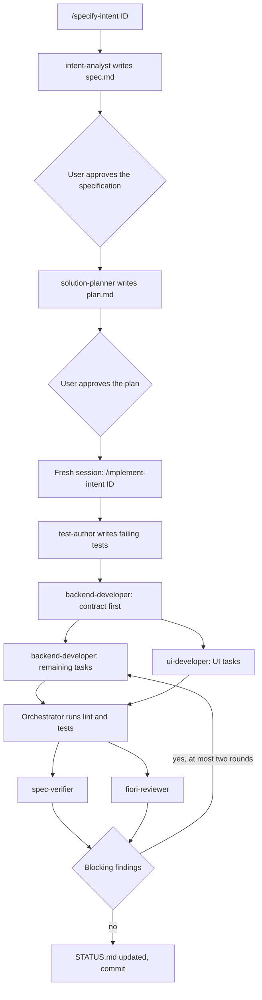

# Close Workspace: Claude Code setup

Version 0.1, 22 November 2026. Built and checked with Claude Code 2.1.330 and Node.js 22.

This document explains how the repository is prepared for development with Claude Code: what each file does, how the subagents work together, how the lint gate works, and how to start. Read it once; Claude Code does not load it.

## 1. Design in one page

**Method.** Intent-based, spec-driven development. Each intent of the intent specification (INT-01 to INT-16), and each foundation item, becomes one work item. A work item passes through four documents on disk: specification, plan, tests, verification. Code is written only against an approved specification and plan.

**Orchestration.** The main Claude Code session is the orchestrator. It delegates to seven subagents, each with one job, a fresh context and the smallest set of rights that job needs. Subagents cannot talk to each other; they hand over through the files in `docs/work/<ID>/` and report back in a few lines. This keeps the orchestrator's context small, which is the main constraint on quality in a long session.

**Enforcement.** Three levels, from soft to hard:

| Level | Mechanism | Used for |
|---|---|---|
| Advice | `CLAUDE.md`, `.claude/rules/` | What Claude should know and usually follows |
| Procedure | Skills, subagent prompts | The order of work and the human approval points |
| Guarantee | Hooks, permissions | What must hold every time: lint gate, write areas, protected files |

**Why subagents and not an agent team.** The work of one intent is sequential with one short parallel step, and workers only need to report back. That is the case subagents are made for. Agent teams are experimental, disabled by default and cost more; they pay off when workers must debate with each other. To work on two intents at the same time, run two sessions in two git worktrees instead.

## 2. Files

```
CLAUDE.md                          project memory: purpose, non-negotiables, sources of truth, commands, workflow
.mcp.json                          MCP servers for CAP, SAPUI5 and SAP Fiori tools
.claude/
  settings.json                    permissions and hooks, shared through git
  rules/                           loaded only when Claude touches matching files
    cds-model.md                   db/**/*.cds, srv/*.cds, app/**/*.cds, seed data
    service-layer.md               srv/**/*.ts, mock-bank/**/*.ts
    agents-and-policy.md           agents, policy, impact, orchestrator, adapters, ports (rules R1 to R13)
    ui5-freestyle.md               app/workspace/**
    fiori-elements.md              app/governance/**, app/admin/**
    i18n.md                        *.properties, db/labels.cds
    tests.md                       test/**
    btp-deploy.md                  mta.yaml, xs-security.json, package.json
    work-items.md                  docs/work/**
  agents/                          the seven subagents (section 3)
  skills/                          /work-status, /specify-intent, /implement-intent, /verify-intent
  hooks/
    lint-gate.mjs                  Stop and SubagentStop: runs the lint kit when an iteration ends
    guard-edits.mjs                PreToolUse: generated folders, credential files, unexplained suppressions
    restrict-writes.mjs            PreToolUse: write area per subagent, from roles.json
    roles.json                     the write areas
    format-on-edit.mjs             PostToolUse: Prettier on the edited file
    session-start.mjs              SessionStart: build status into the context
    selftest.mjs                   checks the guards without Claude Code
docs/
  intent-spec.md, architecture-spec.md, development-standards.md
  deviations.md, fiori-deviations.md
  work/STATUS.md                   the list of work items in build order
  work/_templates/                 spec.md, plan.md, verification.md
  work/<ID>/                       created per work item
```

`CLAUDE.md` has about 110 lines. It holds only what every session needs and what Claude cannot work out from the code. Everything that applies to one layer is in a rule file with a `paths` filter, so it costs context only when that layer is touched. The two specifications are not imported: they are large, and Claude is told to find sections by ID.

## 3. Subagents

| Subagent | Job | Writes | Tools |
|---|---|---|---|
| `intent-analyst` | Work item to `spec.md` with testable acceptance criteria | `docs/work/` | Read, Grep, Glob, Write |
| `solution-planner` | Approved specification plus existing code to `plan.md`: contract, tasks per owner, tests first | `docs/work/` | Read, Grep, Glob, Bash, Write |
| `test-author` | Failing tests from the acceptance criteria, before the implementation | `test/`, `docs/work/` | All except Agent |
| `backend-developer` | CDS model, services, agents, policy, impact, adapters | `db/`, `srv/`, `mock-bank/`, `test/`, descriptors | All except Agent |
| `ui-developer` | Freestyle SAPUI5 app and the two Fiori elements apps | `app/` | All except Agent |
| `spec-verifier` | Independent check: every acceptance criterion needs evidence | `docs/work/` | Read, Grep, Glob, Bash, Write |
| `fiori-reviewer` | FD and FE rules that need judgement; lists what a person must walk through | `docs/work/` | Read, Grep, Glob, Bash, Write |

Design choices:

- **One job each, short description.** Claude decides when to delegate from the description, so each one says what the agent does and when to use it.
- **Least privilege twice.** The `tools` list limits what an agent can call. `restrict-writes.mjs` limits where it can write, by agent name. A reviewer cannot change code, and the UI developer cannot change a service.
- **The author does not grade the work.** Tests come from the specification before the code exists. Verification runs in a fresh context that has not seen how the code came about, and it must show evidence. The reviewers are told to report only what breaks a criterion or a rule, because a reviewer asked to find gaps will always find some.
- **Files are the handover.** Each agent reads `spec.md` and `plan.md` and writes its result to the work item folder. The reply to the orchestrator is limited to 15 lines.
- **Models.** No agent sets `model`, so all use the model of the session. To spend less, set `model: sonnet` on the two developers and `test-author`; keep the strongest model for the planner and the two reviewers.

## 4. Workflow



- **Two approval points for a person**: the specification and the plan. After that the build runs without questions unless a specification is wrong, a Must rule cannot be met, or a dependency or deviation is needed.
- **Two sessions per work item**: one to specify and plan, a fresh one to implement. The implementing session starts with a clean context and the written documents as its only source.
- **Parallel work** happens in two places only: backend and UI developers after the contract is fixed, if the plan says it is safe; and the two reviewers, which only read.
- **Small changes skip all of this.** If the change fits in one sentence, Claude does it directly; the lint gate still applies.

## 5. The lint gate

Your requirement: lint must run whenever Claude finishes an iteration. `lint-gate.mjs` is registered for two events:

| Event | When | Scope |
|---|---|---|
| `Stop` | The main session is about to end its turn | All changed files |
| `SubagentStop` | `backend-developer`, `ui-developer` or `test-author` is about to finish | Changed files in that agent's write area |

How it behaves:

1. It collects the files changed since the last passing run: uncommitted files, and files committed in this session.
2. If only documentation changed, or nothing changed, it exits at once. A turn that only answers a question costs nothing.
3. It selects the lint steps from the changed paths (a change in `srv/policy/` runs ESLint, the compiler, formatting and file names; a change under `app/` adds the Fiori gates, texts and the UI5 linter; a change to the lint kit or `package.json` runs everything) and calls `node tools/lint/run.mjs --only <steps>`.
4. On failure it exits with code 2 and prints the failing sections. Claude Code does not let Claude stop and hands it the findings.
5. It cannot loop forever. If Claude tries to stop again without having changed a file, or after six failed rounds in one turn, the gate lets it stop and shows you a warning that lint is still red. Claude Code has its own cap of eight consecutive continuations on top.

On the sample project a run on one changed TypeScript file took about 11 seconds, and all nine steps about 22 seconds.

Settings, as environment variables (for example in `.claude/settings.local.json` under `env`):

| Variable | Effect |
|---|---|
| `LINT_GATE=off` | Skip the gate |
| `LINT_GATE_FULL=1` | Always run all nine steps |
| `LINT_GATE_MAX_ATTEMPTS=6` | Failed rounds per turn before Claude may stop |

The gate runs lint, not the tests. Tests are run by the developers, by the orchestrator and by `spec-verifier` as part of the workflow, because a full test run on every stop would slow every turn. If you want tests in the gate as well, add a second command to the `Stop` hook that runs `npm test`.

## 6. Other hooks and permissions

| Hook | Event | What it guarantees |
|---|---|---|
| `guard-edits.mjs` | PreToolUse on Edit, Write | No edit in `gen/`, `dist/`, `node_modules/`. No write to `.env`, `default-env.json`, `.cdsrc-private.json`. No `eslint-disable`, `@ts-ignore`, `@ts-expect-error` or `ui5lint-disable` without a reason. |
| `restrict-writes.mjs` | PreToolUse on Edit, Write | Each subagent writes only in its area |
| `format-on-edit.mjs` | PostToolUse on Edit, Write | The edited file is formatted, so formatting never costs a gate round |
| `session-start.mjs` | SessionStart | Claude starts with the branch, the work item counts and the next item; after compaction it is told to re-read the current specification and plan |

Permissions in `.claude/settings.json`:

- **Allowed without asking**: npm scripts, tests, `cds`, lint tools, local git (status, diff, log, add, commit, switch, branch), the three MCP servers.
- **Ask first**: `npm install`, `git push`, `cf`, `mbt`, and edits to the lint kit, the ESLint and compiler configuration, `.claude/`, and the three governing documents.
- **Denied**: reading or editing the credential files, `git commit --no-verify`, force push, hard reset.

The hooks guard Claude's file tools, not shell commands. The deny rules for the credential files also cover the file commands Claude Code recognises in a shell command, such as `cat`, `sed` and redirections; the write areas do not. The lint gate, the pre-commit hook and the pipeline remain the backstop.

## 7. MCP servers

`.mcp.json` registers three servers published by SAP: `cds` (`@cap-js/mcp-server`, model and documentation search for CAP), `ui5` (`@ui5/mcp-server`, for example API reference, guidelines and the UI5 linter), and `fiori` (`@sap-ux/fiori-mcp-server`, generation and change of Fiori elements apps). Claude Code asks you to approve them the first time. They need network access to npm at start. On native Windows, `npx` may need a `cmd /c` prefix: change `"command": "npx"` to `"command": "cmd"` and put `"/c", "npx"` in front of the arguments.

## 8. Getting started

1. Unpack the seed into an empty folder. Set `appIdPrefix` in `tools/lint/standards.config.mjs` to your own reverse-domain prefix.
2. `git init`, then `npm install` (this activates the git hooks), then `npm run lint:selftest` and `node .claude/hooks/selftest.mjs`. Both must pass.
3. Commit: `chore(lint): add repository seed`. The lint gate compares against git, so it needs this first commit.
4. Start `claude` in the folder **interactively once** and accept the trust dialog and the MCP servers. Until the folder is trusted, Claude Code ignores the allow rules of the project.
5. Run `/context` and check that `CLAUDE.md` is loaded; `/hooks` shows the five hook events; `/agents` shows the seven subagents.
6. First prompts:

   ```
   /work-status
   /specify-intent F-01
   ```

   then, in a fresh session, `/implement-intent F-01`.

Recommended order: the foundation items F-01 to F-06, then the Must intents in the order of `docs/work/STATUS.md`. After INT-08 the minimum storyline (scenes 1, 2 and 6) can be shown.

Useful built-in commands alongside: `/clear` between work items, `/code-review` for a second bug-focused review of a diff, `/rewind` to undo a step.

## 9. Maintaining the setup

- **Claude ignores a rule**: first check that `CLAUDE.md` has not grown. Remove what Claude does correctly without being told. If the rule must hold every time, turn it into a lint check or a hook instead of adding emphasis.
- **Claude asks something the documents answer**: the wording is ambiguous; fix the document, not the prompt.
- **A new app or layer**: add a rule file with a `paths` filter, add the write area to `roles.json`, and register the app in `tools/lint/standards.config.mjs`.
- **A new subagent**: add it only for a job that is self-contained, produces a lot of reading the orchestrator does not need, or needs different rights. Otherwise extend an existing one.
- **Changing a lint rule**: follow section 13.4 of the development standards. Claude must ask before it edits the lint kit.

## 10. What was checked, and what was not

Checked:

- Claude Code 2.1.330 loads the project: it parsed `settings.json` (21 allow rules, five hook events), and discovered the seven subagents and four skills.
- Each hook script was run with simulated hook input on a sample CAP and SAPUI5 project in a git repository: 17 guard cases (repeatable with `node .claude/hooks/selftest.mjs`), the session-start output, and 13 lint-gate cases (clean tree, documentation only, broken file, repeat without change, subagent scoping, fix, bad change already committed, attempt cap, no git repository).
- The getting-started steps on a fresh copy of the seed (Linux, Node.js 22): `git init`, `npm install`, both self-tests, `npm run lint`, and the first commit through the pre-commit and commit-msg hooks.

Not checked:

- A live Claude Code turn. The sandbox used for building this had no model access, so the hooks were not executed by Claude Code itself, and no subagent or skill has run. Expect to tune prompts after the first two work items.
- Windows and macOS. The hooks are plain Node.js and are started as `node <script>` without a shell, which is the form Claude Code documents for all platforms.
- The three MCP servers were not started.
- That the name of a subagent arrives as `agent_type` in the hook input exactly as written in the agent file. The write areas and the subagent scope of the lint gate depend on it. Check it once: ask Claude to "use the spec-verifier subagent to create srv/x.ts"; the write must be refused.

## 11. References

- Claude Code: [best practices](https://code.claude.com/docs/en/best-practices), [memory and rules](https://code.claude.com/docs/en/memory), [hooks](https://code.claude.com/docs/en/hooks), [subagents](https://code.claude.com/docs/en/sub-agents), [skills](https://code.claude.com/docs/en/skills), [permissions](https://code.claude.com/docs/en/permissions), [agent teams](https://code.claude.com/docs/en/agent-teams)
- SAP MCP servers: [`@cap-js/mcp-server`](https://www.npmjs.com/package/@cap-js/mcp-server), [`@ui5/mcp-server`](https://www.npmjs.com/package/@ui5/mcp-server), [`@sap-ux/fiori-mcp-server`](https://www.npmjs.com/package/@sap-ux/fiori-mcp-server)
